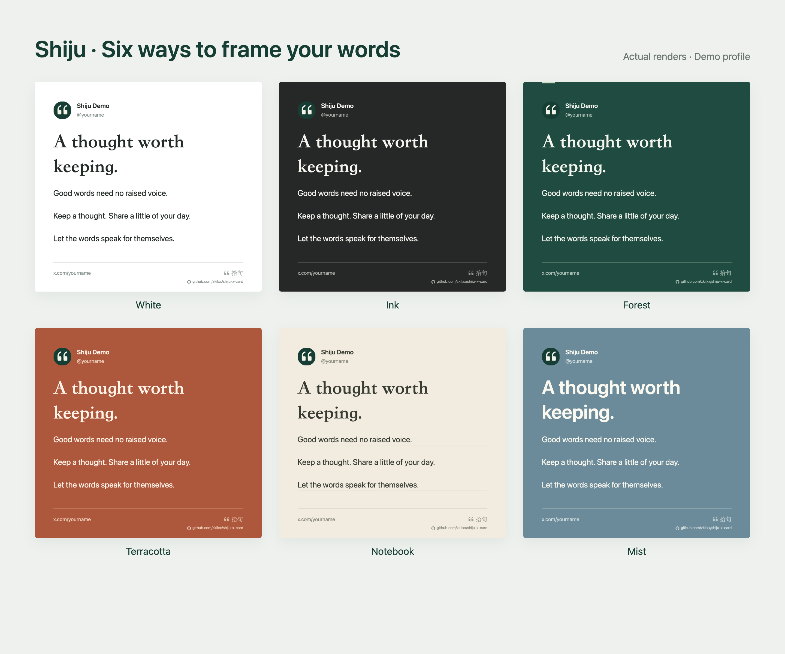
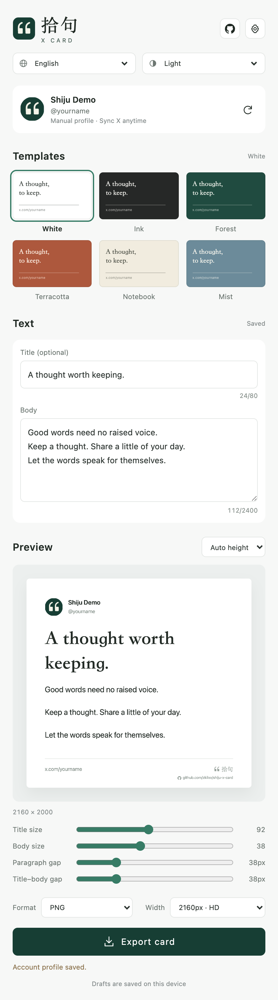
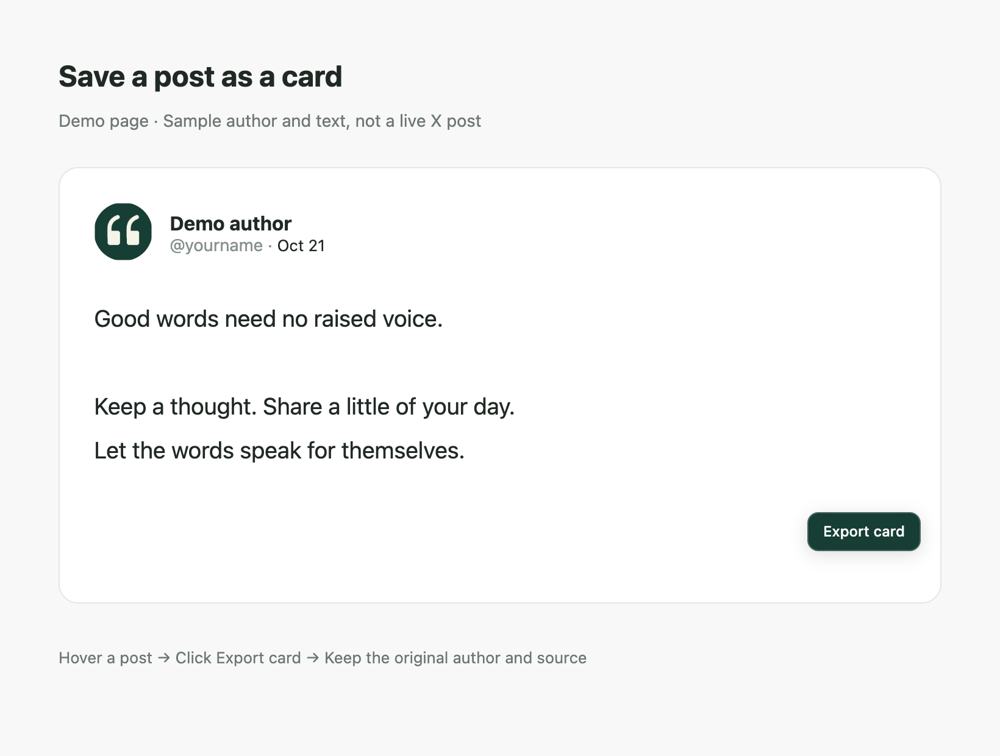

[简体中文](README.md) · [English](README.en.md)

<div align="center">
  
  <h1>Shiju · X Text Cards</h1>
  <p>Turn your thoughts and favorite X posts into beautiful cards, right in Chrome's side panel.</p>
  <p>
    
    
    
    
  </p>
  <p><a href="https://github.com/zkilxx/shiju-x-card/releases/latest">Download</a> · <a href="#installation">Install</a> · <a href="#usage">How to use</a> · <a href="https://github.com/zkilxx/shiju-x-card/issues">Report an issue</a></p>
</div>



No API key and no build step. Sync the X account signed in to your browser, write a title and body, choose a template, and export a PNG or JPG featuring your avatar, display name, handle and profile address. You can also hover over a post and export it with its original author and source.

> Screenshots and sample cards are rendered by the actual extension using demo profiles. The post-export illustration uses a simulated page to demonstrate the hover button.

## Features

| Feature | Details |
| --- | --- |
| Six templates | White, Ink, Forest, Terracotta, Notebook and Mist; notebook rules follow body text without crossing the title |
| Chinese and English | Switch languages from the top toolbar; your preference is saved separately from your draft |
| X profile sync | Sync your signed-in account's avatar, display name, handle and profile address, or enter them manually |
| Post-to-card export | Hover over a post and click Export card; preserve its original author and post address |
| Independent typography | Adjust title size, body size, paragraph spacing and the title–body gap independently |
| High-resolution images | Lossless PNG or highest-quality JPG at widths of 1080, 2160 or 3240px; default is 2160px PNG |
| Flexible sizes | Auto height, square 1:1 or portrait 4:5 |
| Light and dark UI | Follow the system or choose manually; UI appearance does not change card colors |
| Local drafts | Save text, styling and profile details on this device; restore your own draft after exporting someone else's post |
| GitHub links | Open the repository from the header button; every card includes a GitHub icon and repository address below the Shiju brandmark |

## Interface

<p align="center"></p>

Select **English** in the language menu at the top. Language changes affect controls, dialogs, status messages and post-export buttons. The brand name remains **拾句** in both languages. Your title, body text, profile and exported card content are preserved. The unlinked demo account uses the X mark as its placeholder avatar.

## Installation

Requires desktop Chrome 116 or later. The extension is currently installed as an unpacked extension; it is not listed in the Chrome Web Store.

1. Download `shiju-x-card-1.4.0.zip` from [Releases](https://github.com/zkilxx/shiju-x-card/releases/latest) and extract it.
2. Open `chrome://extensions` and enable **Developer mode** in the top-right corner.
3. Click **Load unpacked** and select the extracted **extension** folder, which contains `manifest.json`.
4. Pin Shiju from Chrome's extensions menu, then click its icon to open the side panel.
5. Open [X](https://x.com) in the same Chrome window, sign in and use the sync button beside your profile.
6. Choose **English** from the language menu if needed.

```text
Downloaded ZIP
└── extension/              ← Select this folder in Chrome
    ├── manifest.json
    ├── sidepanel.html
    └── ...
```

Alternatively, clone the repository and load its `extension/` directory directly. You do not need npm or a build command to install the extension:

```sh
git clone https://github.com/zkilxx/shiju-x-card.git
cd shiju-x-card
```

To update, replace the files in the installed folder, click **Reload** for Shiju in `chrome://extensions`, then close and reopen the side panel. Refresh X if its hover buttons have not updated.

## Usage

### Write a card

1. Sync your X account, or open profile settings to enter your name and handle and upload an avatar.
2. Choose a template and write a title and body. The title is optional.
3. Adjust typography and spacing while viewing the live preview.
4. Choose the aspect ratio, format and image width, then click **Export card**. The image is saved to your browser's download location.

**Paragraph gap** adds space between paragraphs: a single Enter starts a new paragraph; automatically wrapped lines keep their existing line spacing. Extra blank lines retain one line of height. Paragraph gap and title–body gap each range from 0 to 160px at a 1080px card width. Larger exports scale them proportionally; fixed-ratio cards scale spacing along with text when fitting content.

Use the default **2160px PNG** for a sharp, lossless image, or choose 3240px for a larger export. JPG uses maximum-quality encoding. Addresses printed on a card are image text and cannot be clicked. The GitHub button in the extension header opens the repository in a new tab.

### Save a post



1. Hover over a post on X and click **Export card** in its bottom-right corner.
2. Shiju uses the current template and export settings, displaying the **original author's** avatar, name, handle and original post address.
3. Click **Back to my draft** to restore your own title, body and typography.

Only the post's text is exported. Images, videos and quoted posts are excluded. Expand collapsed long posts first. Missing text and content over the length limit produce a message instead of a silently truncated export.

## Privacy and permissions

Shiju reads visible profile details and public avatars using your existing X session. Your own identity comes from the signed-in account switcher rather than a profile you happen to be viewing.

Drafts, profiles, avatar caches, language and appearance preferences stay on your device. The extension has no backend, analytics or content-upload endpoint. It does not read passwords, cookies or direct messages, or automate posting and following.

| Permission or site | Purpose |
| --- | --- |
| `sidePanel` | Open Chrome's native side panel |
| `storage` | Save local drafts, profiles and preferences |
| `activeTab`, `scripting` | Attempt to read an X tab that was open before installation |
| `x.com`, `twitter.com` | Read visible account/post details and add hover export buttons |
| `pbs.twimg.com` | Fetch public avatars and convert them to local image data for Canvas export |

When X is unavailable, signed out or still loading, cached profiles are marked as unverified. Check the identity before exporting, or enter a profile manually.

## Limitations

- Built for desktop Chrome 116 and later.
- Body text is limited to 2400 UTF-16 code units. Chinese, English, links and emoji are supported; some emoji occupy multiple code units.
- Fixed ratios shrink text within a readable range. If it still does not fit, switch to Auto height; content is never silently cropped. Extremely tall cards must be split.
- Editing and export work offline after the profile and avatar are cached. Initial X sync and avatar retrieval require a network connection.
- X's page structure may change. Refresh X, try syncing again, or report problems through Issues.

## Development

Requires Node.js 20 or later. The extension uses plain JavaScript, CSS and Canvas with no bundler. npm dependencies are used only for verification and documentation screenshots.

```sh
npm ci
npx playwright install chromium
npm test
```

The regression suite loads the real extension in an isolated temporary Chrome profile. X pages use mocked responses. Coverage includes profile synchronization, post buttons and downloads, draft restoration, templates, typography, paragraph spacing, notebook rules, languages, appearance and identical PNG preview/export pixels. Mocked tests do not guarantee live compatibility after every X page update.

Regenerate documentation screenshots with demo profiles:

```sh
node scripts/capture-docs.cjs
```

Scripts retain temporary browser profiles and artifacts instead of deleting local files automatically.

For a web-only editor preview:

```sh
cd extension
python3 -m http.server 4387 --bind 127.0.0.1
```

Open `http://127.0.0.1:4387/sidepanel.html`. Templates, manual profiles and export work in preview mode; syncing X requires the installed extension.

```text
extension/                  Loadable Chrome extension
  account.js                Account and post extraction
  background.js             Sync, avatar retrieval and export coordination
  content.js / content.css  Post hover buttons
  panel.js / sidepanel.html Editor, drafts and export interactions
  render.js                 Canvas rendering and templates
  i18n.js / branding.js      Language preferences, translations and GitHub mark
  theme.js / styles.css     System appearance and interface styles
docs/images/                Actual UI screenshots for the README
scripts/capture-docs.cjs     Screenshot generator
tests/verify.cjs             Regression suite
design/                     Initial concept and visual specifications
```

References: [Chrome Side Panel API](https://developer.chrome.com/docs/extensions/reference/api/sidePanel), [Content Scripts](https://developer.chrome.com/docs/extensions/develop/concepts/content-scripts).

The GitHub mark comes from [Primer Octicons](https://github.com/primer/octicons). Its MIT notice is included in [THIRD_PARTY_NOTICES.txt](extension/THIRD_PARTY_NOTICES.txt).
