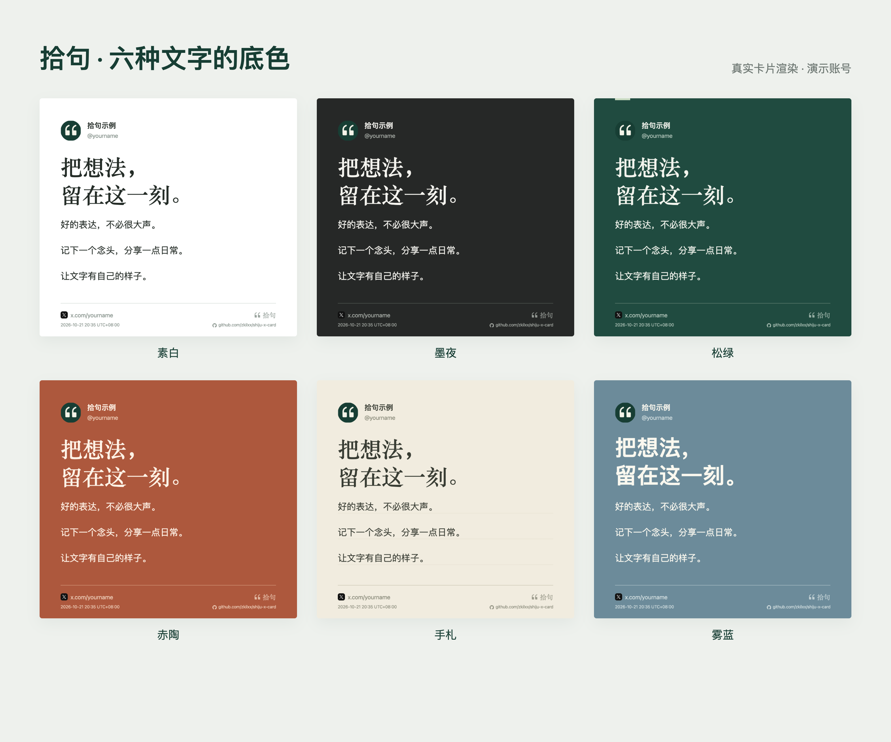
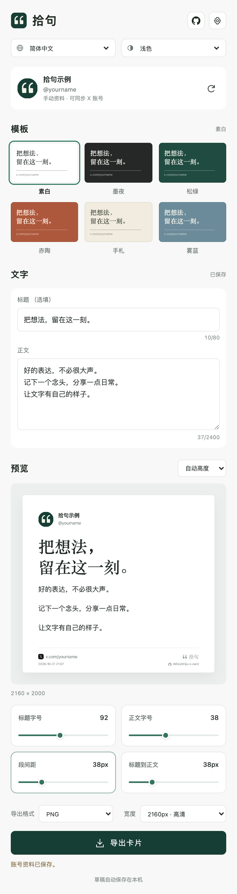
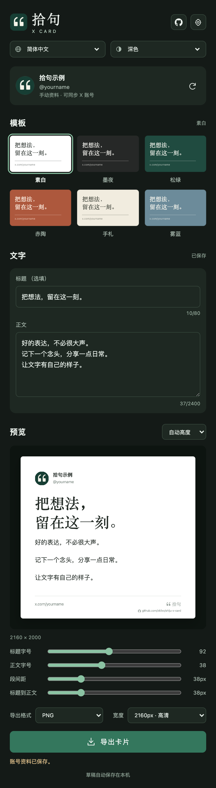
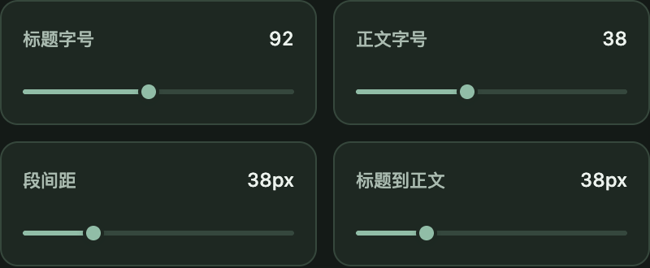
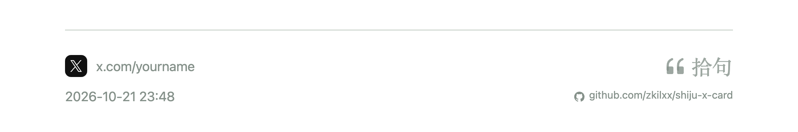
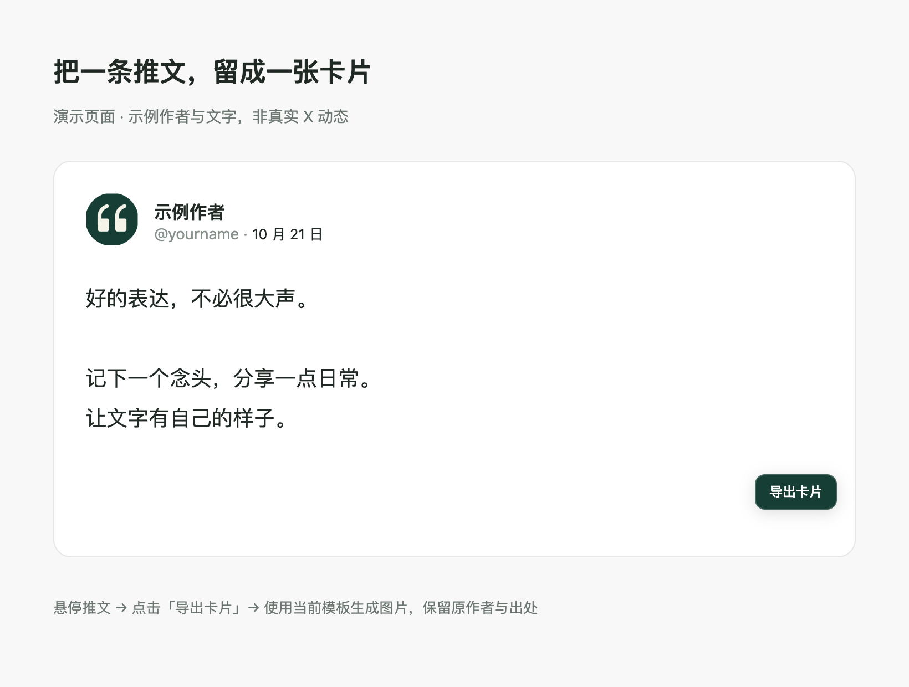

[简体中文](README.md) · [English](README.en.md)

<div align="center">
  
  <h1>拾句 · X 文字卡片</h1>
  <p>在 Chrome 侧边栏，把想法和喜欢的推文做成一张好看的卡片。</p>
  <p>
    
    
    
    
  </p>
  <p><a href="https://github.com/zkilxx/shiju-x-card/releases/latest">下载插件</a> · <a href="#安装">安装方法</a> · <a href="#使用">使用说明</a> · <a href="https://github.com/zkilxx/shiju-x-card/issues">反馈问题</a></p>
</div>



无需 API Key，无需构建。同步当前登录的 X 账号，输入标题与正文，选择模板，即可导出带头像、昵称、ID 和主页地址的 PNG / JPG 图片。也可以悬停一条推文，直接为原作者生成卡片，保留署名与出处。

> 本文界面与卡片截图均由插件实际渲染，使用演示资料；推文导出图使用模拟页面展示按钮位置。

## 能做什么

| 功能 | 说明 |
| --- | --- |
| 中英双语 | 顶部可切换简体中文 / English，语言偏好单独保存，原文和账号资料保持不变，品牌名始终显示「拾句」 |
| 卡片时间 | 链接前有圆角方形 𝕏 标记，下方显示时间戳；自己的文字使用本次导出时间，推文使用原文发布时间，并标注本地时区 |
| GitHub 入口 | 左上角展示插件 Logo，右上角 GitHub 按钮直达仓库；卡片右下角 Logo 下附 GitHub 图标与仓库地址 |
| 六套模板 | 素白、墨夜、松绿、赤陶、手札、雾蓝；手札横线跟随正文，不穿过标题 |
| 演示资料 | 未关联账号时使用拾句 Logo 占位；同步或上传头像后显示真实头像 |
| 账号同步 | 读取当前 X 登录账号的头像、昵称、@ID 和主页地址，支持手动编辑与头像上传 |
| 推文转卡片 | 鼠标悬停推文后点击「导出卡片」，使用当前模板，保留原作者和原推文链接 |
| 独立排版 | 标题字号、正文字号、段间距、标题与正文间距分别调整 |
| 高清导出 | PNG 无损 / JPG，宽度 1080、2160 或 3240px；默认 2160px PNG |
| 多种比例 | 自动高度、正方形 1:1、竖版 4:5 |
| 深浅色界面 | 跟随系统或手动切换，界面主题不影响卡片配色 |
| 本机草稿 | 自动保存文字、账号和样式；从别人推文返回时可恢复自己的草稿 |

## 界面预览

<table>
  <tr><th>浅色</th><th>深色</th></tr>
  <tr>
    <td></td>
    <td></td>
  </tr>
</table>

## 安装

目前通过 Chrome 的「加载已解压的扩展程序」安装，尚未上架 Chrome 应用商店。

1. 前往 [Releases](https://github.com/zkilxx/shiju-x-card/releases/latest)，下载 `shiju-x-card-1.5.2.zip` 并解压。
2. 在 Chrome 地址栏输入 `chrome://extensions`，打开右上角的「开发者模式」。
3. 点击「加载已解压的扩展程序」，选择解压后的 **extension** 文件夹，里面应有 `manifest.json`。
4. 在 Chrome 工具栏的扩展菜单中固定「拾句」，点击图标打开侧边栏。
5. 在同一 Chrome 窗口打开并登录 [X](https://x.com)，点击侧边栏账号行右侧的同步按钮。

```text
下载的 ZIP
└── extension/              ← 在 Chrome 中选择这一层
    ├── manifest.json
    ├── sidepanel.html
    └── ...
```

也可以克隆源码，直接加载项目中的 `extension/`，不需要运行 npm 或构建命令：

```sh
git clone https://github.com/zkilxx/shiju-x-card.git
cd shiju-x-card
```

更新时，用新版文件替换原扩展目录，在 `chrome://extensions` 点击拾句的「重新加载」，关闭再打开侧边栏。插件会尝试重新连接已打开的 X 页面并替换旧按钮；如果仍提示连接失效，刷新一次 X 页面后重试。

## 使用

### 写自己的卡片

1. 同步 X 账号，或通过右上角资料按钮手动填写昵称、ID 并上传头像。
2. 选择模板，输入标题和正文。标题可以留空。
3. 调整字号、段间距、标题到正文的距离，实时查看卡片。
4. 选择比例、格式与宽度，点击「导出卡片」。图片保存到浏览器下载位置。

**段间距**是段落之间的额外留白：单次回车就分段，自动折行的行距保持不变；手动多留的空行仍保留一行高度。段间距和标题到正文间距均可设为 0–160px，按 1080px 卡片宽度计算。导出更大图片时会同比放大；固定比例需要缩小字号时，间距也同步缩放。

推荐使用默认的 **2160px PNG**。需要更大尺寸可选 3240px；JPG 使用最高质量编码。图片中的主页或推文地址是可读文字，不是可点击链接。



时间按浏览器所在时区显示，包含年月日、时分和 UTC 偏移。自己的卡片每次点击导出都会更新时间，预览随之同步；读取不到推文的实际发布时间时会提示重试。旧版保存的推文草稿若缺少时间信息，需要回到 X 重新生成。



### 收藏一条推文



1. 将鼠标放在一条 X 推文上，点击右下角「导出卡片」。
2. 侧边栏使用当前模板和导出设置生成图片，卡片显示**原作者**头像、昵称、ID 和原推文地址。
3. 点击「返回我的草稿」，恢复自己的标题、正文和排版设置。

仅提取该推文的文字，不包含配图、视频和引用推文的内容。折叠长推文请先展开；没有文字或超出长度限制时会提示，不会截断后直接导出。

## 账号、隐私与权限

账号关联使用浏览器中已有的 X 登录状态，只读取可见页面中的账号资料和公开头像。账号同步以左侧登录账号切换入口为准，不把正在浏览的他人主页当成自己的账号。

草稿、资料、头像缓存和主题偏好保存在本机。插件没有后端、统计或内容上传接口，不读取密码、Cookie 或私信，也没有发推、关注等自动操作。

| 权限 / 网站范围 | 用途 |
| --- | --- |
| `sidePanel` | 打开 Chrome 原生侧边栏 |
| `storage` | 保存本机草稿、账号资料和主题偏好 |
| `activeTab`、`scripting` | 尝试在安装前已打开的 X 页面中读取账号资料 |
| `x.com`、`twitter.com` | 读取账号与推文文字，添加悬浮导出按钮 |
| `pbs.twimg.com` | 下载公开头像并转为本机图片数据，供 Canvas 导出 |

未打开 X、尚未登录或页面资料未就绪时，会提示同步失败，并明确标记缓存账号「未确认当前账号」。请确认身份后再导出，也可以手动编辑资料。

仓库入口为 [github.com/zkilxx/shiju-x-card](https://github.com/zkilxx/shiju-x-card)。卡片底部的仓库地址是图片文字；侧边栏右上角的 GitHub 按钮可点击跳转。切换语言仅改变操作界面与提示，不翻译你的标题、正文或账号资料。

## 使用限制

- 需要 Chrome 116 或更新版本；目前针对桌面 Chrome 开发。
- 正文最多 2400 个 UTF-16 字符，支持中文、英文、链接和 emoji；emoji 可能占多个 UTF-16 字符。
- 固定比例会在可读范围内缩小字号，仍放不下时提示切换自动高度，不裁掉文字。自动高度过长时需拆分卡片。
- 已缓存资料后可离线编辑与导出；首次读取 X 账号和下载头像需要联网。
- X 的页面结构可能变化。若账号或推文读取异常，请先刷新页面，再尝试同步或通过 Issues 反馈。

## 本地开发

开发需要 Node.js 20 或更新版本。扩展使用原生 JavaScript、CSS 和 Canvas，没有打包步骤。`npm` 依赖仅用于开发验证与文档截图。

```sh
npm install
npx playwright install chromium
npm test
```

测试使用独立临时 Chrome 配置加载真实扩展，X 页面通过本地模拟响应验证。当前 **37 项回归测试通过**，覆盖账号同步与切换、推文按钮与下载、草稿恢复、六套模板、独立字号、单次回车段间距、手札横线、时间来源与时区、界面主题、PNG 预览/导出一致性和超长内容处理。另包含真实扩展停用/启用后的旧页面重连、重复注入不重复下载、失效连接提示测试；推文导出测试模拟了原生侧边栏打开调用。模拟测试不代表每次 X 网页更新后的线上行为均已实测。

生成 README 截图：

```sh
node scripts/capture-docs.cjs
```

截图使用示例账号，在独立临时浏览器中生成，不需要登录 X。脚本保留临时配置和测试产物，不主动清理本地文件。

只预览编辑器网页时：

```sh
cd extension
python3 -m http.server 4387 --bind 127.0.0.1
```

打开 `http://127.0.0.1:4387/sidepanel.html`。网页模式可试用模板、手动资料和导出；同步当前 X 账号需要安装扩展。

```text
extension/                 Chrome 扩展源码，可直接加载
  account.js               账号与推文资料读取
  background.js            账号同步、头像下载与推文导出调度
  content.js / content.css 推文悬浮按钮
  panel.js / sidepanel.html 编辑器、草稿与导出交互
  render.js                六套模板与 Canvas 渲染
  i18n.js / branding.js     中英文文案、语言偏好与 GitHub 标记
  theme.js / styles.css    系统主题和界面样式
docs/images/               README 真实界面截图
scripts/capture-docs.cjs    文档截图生成脚本
tests/verify.cjs            扩展回归测试
tests/reload.cjs            旧页面重连与扩展生命周期测试
design/                    初始设计概念与视觉规格
```

实现参考：[Chrome Side Panel API](https://developer.chrome.com/docs/extensions/reference/api/sidePanel)、[Content Scripts](https://developer.chrome.com/docs/extensions/develop/concepts/content-scripts)。

GitHub 标记来自 [Primer Octicons](https://github.com/primer/octicons)，MIT 授权说明保存在 [THIRD_PARTY_NOTICES.txt](extension/THIRD_PARTY_NOTICES.txt)。
